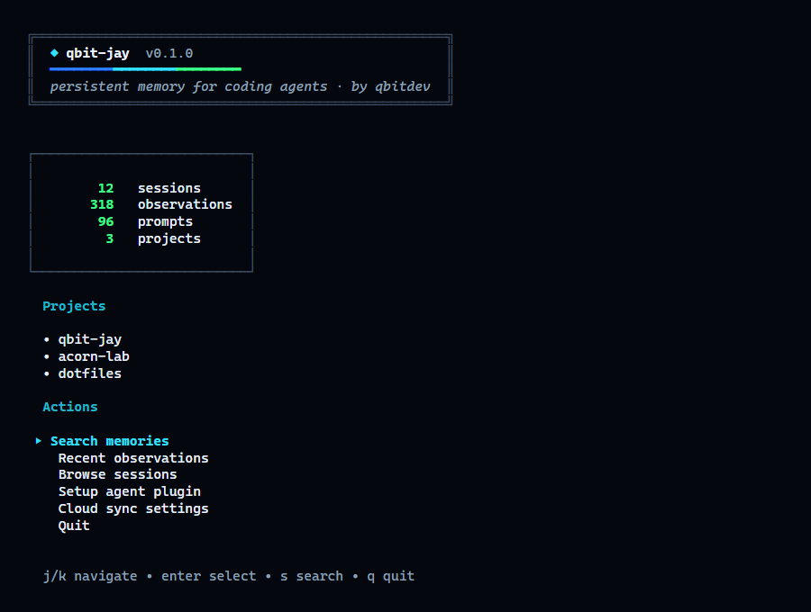
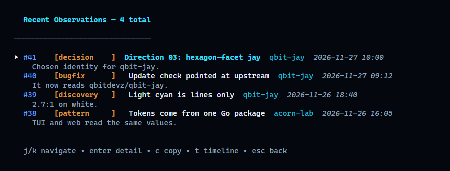
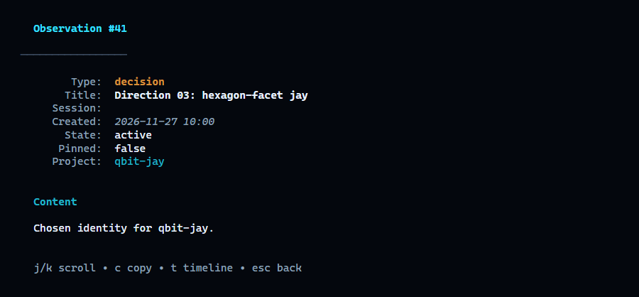
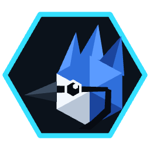

<!-- markdownlint-disable-next-line MD041 -->
<a id="top"></a>

<div align="center">


<h1>qbit-jay</h1>

<p><strong>Persistent memory for AI coding agents.</strong></p>

<p>
<a href="https://github.com/qbitdevz/qbit-jay/stargazers"></a>


<a href="LICENSE"></a>
</p>

<p>
<a href="#get-started"><strong>Quickstart</strong></a> &bull;
<a href="DOCS.md"><strong>Docs</strong></a> &bull;
<a href="docs/AGENT-SETUP.md"><strong>Agent setup</strong></a> &bull;
<a href="#attribution"><strong>Attribution</strong></a>
</p>

<br/>

<p>
<strong>jay</strong> — the bird (Spanish <em>arrendajo</em>) that hides food in thousands of places and remembers where.
</p>

<p>
Your AI coding agent forgets everything when the session ends.
<strong>qbit-jay gives it a memory that lasts.</strong>
</p>

<p><sub>One memory. Local or cloud. Agent-agnostic, single binary, zero dependencies.</sub></p>

<br/>

<sub><strong>WORKS WITH THE AGENT YOU ALREADY HAVE</strong></sub>

<strong><a href="docs/AGENT-SETUP.md#claude-code">Claude Code</a></strong> ·
<strong><a href="docs/AGENT-SETUP.md#pi">Pi</a></strong> ·
<strong><a href="docs/AGENT-SETUP.md#opencode">OpenCode</a></strong> ·
<strong><a href="docs/AGENT-SETUP.md#gemini-cli">Gemini CLI</a></strong> ·
<strong><a href="docs/AGENT-SETUP.md#codex">Codex</a></strong> ·
<strong><a href="docs/AGENT-SETUP.md#antigravity">Antigravity</a></strong> ·
<strong><a href="docs/AGENT-SETUP.md#windsurf">Windsurf</a></strong><br/>
<strong><a href="docs/AGENT-SETUP.md#qwen-code">Qwen Code</a></strong> ·
<strong><a href="docs/AGENT-SETUP.md#kiro">Kiro</a></strong> ·
<strong><a href="docs/AGENT-SETUP.md#cursor">Cursor</a></strong> ·
<strong><a href="docs/AGENT-SETUP.md#vs-code-copilot--claude-code-extension">VS Code (Copilot)</a></strong> ·
<strong><a href="docs/AGENT-SETUP.md#kilo-code">Kilo Code</a></strong> ·
<strong><a href="docs/AGENT-SETUP.md#kimi-code">Kimi Code</a></strong> ·
<strong><a href="docs/AGENT-SETUP.md#commandcode">CommandCode</a></strong>

<sub>14 setup targets · plus any MCP-compatible agent · <a href="docs/AGENT-SETUP.md">per-agent setup →</a></sub>

</div>

## The name

A jay hides food in many places and finds it again later. That is the job of this tool, for your agent's work.

- **What, where, when.** Scrub jays were the first animals shown to remember *what* they hid, *where* and *when* ([Clayton and Dickinson, *Nature*, 1998](https://doi.org/10.1038/26216)). qbit-jay keeps the same three for your project: the memory itself, the project and files it belongs to, and when it was saved.
- **Hide thousands, recall months later.** The acorns on the banner are the memories your agent saves; the grid cells are the operations around them (`save`, `search`, `context`, `sync`, `recall`, `remember`).

## Attribution

qbit-jay is based on [Engram](https://github.com/Gentleman-Programming/engram) by Gentleman Programming (Alan Buscaglia), under the MIT license. It is an independent fork with its own name and identity; it is not official, sponsored or endorsed by the Engram project. See [UPSTREAM-DELTA.md](UPSTREAM-DELTA.md) for every point where it differs, [LICENSE](LICENSE) for the copyright lines and [TRADEMARKS.md](TRADEMARKS.md) for the upstream trademark policy.

<div align="right"><a href="#top">Back to top</a></div>

## Features

---

### One binary — Memory without a stack

```
Agent (Claude Code / OpenCode / Gemini CLI / Codex / VS Code / Antigravity / ...)
    ↓ MCP stdio
qbit-jay (single Go binary)
    ↓
SQLite + FTS5 (~/.qbit-jay/qbit-jay.db)
```

Codex mutating qbit-jay tools require the running core's `/health` response to advertise `capabilities.runtime_session_resolution: true` before resolving the host session. `root_session_resume` alone is not sufficient. If the core is incompatible, upgrade it to match the CLI, manually restart the running qbit-jay server, and start a new Codex session. Hooks never restart the server automatically. Unregistered sessions and connection or invalid-response failures remain safely blocked with distinct diagnostics; read-only and non-qbit-jay calls are unaffected.

A **Go binary** with SQLite + FTS5 full-text search, exposed through CLI, HTTP API, MCP, and an interactive TUI. It works with any MCP-compatible agent, including Claude Code, OpenCode, Gemini CLI, Codex, VS Code (Copilot), Antigravity, Cursor, and Windsurf. No Node.js, Python, or Docker is required: one binary, one SQLite file.

The data directory defaults to `~/.qbit-jay` (`%USERPROFILE%\.qbit-jay` on Windows); a nonblank `QBIT_JAY_DATA_DIR` overrides it and must be an absolute path. The legacy `ENGRAM_DATA_DIR` is still read when `QBIT_JAY_DATA_DIR` is not set. On Windows, local-SQLite commands (including `serve`, `mcp`, and `doctor`) create and check `<data-directory>/tmp/sqlite` before opening SQLite, then set `TEMP` and `TMP` for that process only. Startup fails with an operation-specific diagnostic if the directory cannot be used. User/system environment settings and the working directory are unchanged. The directory is shared between processes and is not cleaned by qbit-jay; SQLite manages its own uniquely named temporary files. This preparation also covers cloud `status`, `enroll`, `unenroll`, `attest-prompt-source`, and the local-store `cloud upgrade` operations (`doctor`, `repair`, `bootstrap`, `remirror`, `status`, `rollback`). It does not run for `protocol-mode`, `setup`, `cloud serve`, `cloud config`, top-level `cloud repair` or `cloud bootstrap` (distinct from the included `cloud upgrade repair` and `cloud upgrade bootstrap`), other `cloud upgrade` subcommands, or unknown commands. Existing orphan-database migration behavior is unchanged, including for commands excluded from this preparation. Linux/macOS, config-free commands, isolated self-tests, `compatibility`, and `migrate-copy` retain their existing behavior.

**[Docs →](docs/ARCHITECTURE.md)**

---

### Project-aware — The right memory for the right repo

Project-aware reads use the canonical current project when no selector is supplied: an explicit project, then `QBIT_JAY_PROJECT` (or the legacy `ENGRAM_PROJECT`), then cwd detection. Use `--all` in the CLI or `all_projects=true` in HTTP for an intentional global read; do not combine either with an explicit project. `qbit-jay context` retains its positional project as an alias for `--project`. `GET /sync/status` supports one resolved project and rejects `all_projects=true` because its provider cannot aggregate status.

**[Docs →](DOCS.md#mcp-project-resolution)**

---

### Local first — Portable when needed

qbit-jay keeps memory local by default. The local SQLite database is authoritative; Git Sync exports portable compressed chunks for sharing across machines, and qbit-jay Cloud is optional, project-scoped replication/shared access with browser visibility.

| Need | Start here |
| --- | --- |
| Local memory and the runtime model | [Architecture](docs/ARCHITECTURE.md) |
| Integrate qbit-jay with a configurator (qbit-ai, gentle-ai) | [Integration contract](docs/INTEGRATION.md) |
| Share memory with Git | [Git Sync reference](DOCS.md#git-sync-chunked) |
| Use optional Cloud replication | [qbit-jay Cloud](docs/engram-cloud/README.md) |
| Diagnose or recover Cloud operations | [Cloud troubleshooting](docs/engram-cloud/troubleshooting.md) |

For an existing local database, use the guided upgrade sequence. If the dry run reports changes, apply them before bootstrap; otherwise continue directly to bootstrap.

```bash
qbit-jay cloud upgrade doctor --project <project>
qbit-jay cloud upgrade repair --project <project> --dry-run
qbit-jay cloud upgrade repair --project <project> --apply # only when the dry run reports changes
qbit-jay cloud upgrade bootstrap --project <project>
qbit-jay cloud upgrade status --project <project>
```

**[Docs →](DOCS.md#cloud-upgrade-flow)**

---

### Terminal UI — Browse what your agent remembers

```bash
qbit-jay tui
```

<p align="center">
  <br/><br/>
  <br/><br/>
  
</p>

The screens above are the real TUI rendered with sample data. Navigate with `j`/`k`, use `Enter` to drill in, `c` to copy content to the clipboard, `/` to search, and `Esc` to go back. The TUI reads its colours from the same theme tokens as the web dashboard (dark and light).

**[Docs →](DOCS.md#terminal-ui-tui)**

---

### Also in the box

| Component | What it does |
| :--- | :--- |
| **[MCP tools](DOCS.md#mcp-tools-27-tools)** | Save, search, timeline, session, review, and diagnosis tools for your agent |
| **[HTTP API](DOCS.md#http-api-endpoints)** | The same memory over local HTTP endpoints; [compound agent workflows](docs/HTTP-AGENT-WORKFLOWS.md) |
| **[Doctor](docs/DOCTOR.md)** | `qbit-jay doctor` — read-only operational diagnostics |
| **[Conflict surfacing](docs/AGENT-SETUP.md#conflict-surfacing-automatic)** | Flags related or conflicting memories so the agent can judge them |
| **[Plugins](docs/PLUGINS.md)** | OpenCode and Claude Code plugin details |
| **[Pi package](plugin/pi/README.md)** | The qbit-jay package for Pi (package name `qbit-jay-pi`; not distributed through npm, install with `pi install <repo>/plugin/pi`) |
| **[Team usage](docs/TEAM-USAGE.md)** | Shared-memory conventions |
| **[Binary self-testing](docs/SELF-TESTING.md)** | Isolated reliability and performance checks for released binaries |
| **[Obsidian Brain](docs/beta/obsidian-brain.md)** | Export memories as an Obsidian knowledge graph (beta) |

> **Every command, environment variable, and endpoint: [Full reference →](DOCS.md)**

<div align="right"><a href="#top">Back to top</a></div>

<div align="center"></div>

## Get started

### Install

Pick one channel; the scripts verify the release checksum before installing and need no administrator rights.

```bash
# Linux, macOS, WSL
curl -fsSL https://raw.githubusercontent.com/qbitdevz/qbit-jay/main/scripts/install.sh | sh
```

```powershell
# Windows PowerShell
irm https://raw.githubusercontent.com/qbitdevz/qbit-jay/main/scripts/install.ps1 | iex
```

```bash
# Go 1.26 or newer, any platform
go install github.com/qbitdevz/qbit-jay/cmd/qbit-jay@latest

# Homebrew
brew install qbitdevz/tap/qbit-jay

# Scoop
scoop bucket add qbitdevz https://github.com/qbitdevz/scoop-bucket; scoop install qbit-jay
```

```bash
qbit-jay version
```

Or build from a clone: `go build -o qbit-jay ./cmd/qbit-jay`. See [Installation](docs/INSTALLATION.md) and [Releasing](docs/qbit/RELEASING.md) for details.

### Existing Engram data

qbit-jay keeps its data in `~/.qbit-jay/qbit-jay.db` and does not read, copy or change `~/.engram`. Importing an existing Engram database is planned and not available yet.

### Configuration

Every setting is an environment variable named `QBIT_JAY_*` (for example `QBIT_JAY_DATA_DIR`, `QBIT_JAY_PROJECT`, `QBIT_JAY_PORT`). The legacy `ENGRAM_*` names are still accepted; when both are set, the `QBIT_JAY_*` value wins. The full list is in the [reference](DOCS.md).

### Set up your agent

Run the setup command for the agent you use, then restart that agent. `qbit-jay setup` writes the applicable MCP and integration configuration; it does not require you to start a server for the usual stdio-only setup.

| Agent | Setup |
| --- | --- |
| Claude Code | `qbit-jay setup claude-code` |
| Pi | `qbit-jay setup pi` |
| OpenCode | `qbit-jay setup opencode` |
| Gemini CLI | `qbit-jay setup gemini-cli` |
| Codex | `qbit-jay setup codex` |
| Antigravity CLI | `qbit-jay setup antigravity-cli` |
| Windsurf | `qbit-jay setup windsurf` |
| Qwen Code | `qbit-jay setup qwen` |
| Kiro | `qbit-jay setup kiro` |
| Cursor | `qbit-jay setup cursor` |
| VS Code (Copilot) | `qbit-jay setup vscode-copilot` |
| Kilo Code | `qbit-jay setup kilocode` |
| Kimi Code | `qbit-jay setup kimi` |
| CommandCode | `qbit-jay setup commandcode` |
| Another MCP-compatible agent | [Manual MCP setup](docs/AGENT-SETUP.md#any-other-mcp-agent) |

For Claude Code, rerunning setup updates the marketplace and the user-scope `qbit-jay@qbit-jay` plugin when it is already installed; existing project- or local-scope copies are not updated. An update failure fails setup; restart Claude Code after a successful update to load the new hooks.

> **Per-agent configuration, plugin behavior, manual MCP setup, compaction resilience, and troubleshooting: [Agent Setup →](docs/AGENT-SETUP.md)** · Pi users can also find the package in [`plugin/pi`](plugin/pi/README.md).

<div align="right"><a href="#top">Back to top</a></div>

<div align="center"></div>

## Read-only compatibility observations

Before considering an existing store, run the explicit-path probe:

```sh
qbit-jay compatibility --data-dir /absolute/path/to/fixture --json
```

This command dispatches before updates, configuration, orphan migration or
`Store.New`. It reads directory metadata, the SQLite header and `.instance-id`
only; it does not load SQLite, read memories, create directories/locks or repair
identity. Exactly one `--data-dir` and one `--json` are accepted; any other
argument, including `--help`, prints the usage line to stderr. Invalid arguments
or unsafe metadata produce exit 2, no stdout and a diagnostic on stderr.
`qbit-jay help` lists the command. Successful observations produce exit 0 and one
JSON object with `revision: 1`, `source: "offline"`, both authorization flags
false and, for an existing store, its `instance_id`. Status is `fresh` for
an empty directory, `legacy_schema`/`future_schema` for non-current headers,
or `unknown_shape` for a current header. Missing directories, malformed headers,
missing/invalid identity, nonregular database/identity entries, database-name
ambiguity, WAL/SHM/journal sidecars and observed metadata changes are rejected.
Directory aliases are resolved; no filesystem path is returned in the JSON.

**Offline success never authorizes opening an existing store.** A current header
cannot prove schema shape, and normal schema-1 startup still executes DDL and
repairs. These observations are not atomic snapshots or leases; an undetected
race cannot grant permission because offline authorization is always false.

`GET /compatibility` provides the actual running store's startup facts, under
the same optional bearer authentication as other protected API routes. A
successful current-schema startup returns `source: "active"`, `status: "ready"`,
`active_reuse_authorized: true`, its actual `instance_id`, a per-store-opening
random `runtime_id`, and `capability: "startup-verified-store-v1"`. The response
is not derived from `/health`, release version or externally supplied metadata.
Nil, closed, generation-invalidated and future-schema-skipped handles return
`status: "unknown"` and deny reuse. Reads do not open SQLite connections or
resolve configuration. Startup facts do not certify arbitrary external in-place
schema edits or future changes; clients must not treat this response as a lease,
an authentication token or offline migration permission. Compare explicit store
identity when reusing a selected runtime; never silently substitute another
endpoint. Unknown evidence should leave memory disabled, with guidance to back
up, update and restart the existing server, then recheck.

## For agents

Treat qbit-jay as a curated project memory, not a transcript sink. Use this operating contract throughout the session.

1. **Orient before writing.** Start with `mem_current_project` to confirm the resolved project and its source. At the start of related work, use `mem_context` and `mem_search` to recover the relevant history.
2. **Search before repeating.** Before revisiting a decision, bug, convention, or request that may already be known, search with focused terms. Search results are previews, not the complete record.
3. **Retrieve progressively.** Use `mem_search` for candidates, `mem_timeline` when surrounding session context matters, and `mem_get_observation` before relying on a full observation.
4. **Save significant knowledge deliberately.** Save completed bug fixes, decisions, discoveries, configuration changes, patterns, and durable user constraints with `mem_save`. Do not capture raw tool output or every conversational turn.
5. **Keep evolving knowledge stable.** Give an evolving topic a stable `topic_key` such as `architecture/auth-model`; reuse it to update that topic rather than creating competing memories. Use `mem_suggest_topic_key` when the key is unclear.
6. **Leave a handoff.** Before ending a session, save a `mem_session_summary` with the goal, instructions, discoveries, accomplished work, next steps, and relevant files.
7. **Recover after compaction.** Persist the compacted handoff with `mem_session_summary` first. Then call `mem_context` to recover recent session history before continuing.

### When Git initialization changes the detected project

Before creating a repository's first private Git identity, qbit-jay checks local
session history for the exact working directory. If Git suggests `remote-app`
but that directory has history under `local-app`, implicit project selection
stops with `project_transition_conflict` instead of silently changing scope.
History is only a precaution: explicit or imported sessions can also trigger it.

Choose the intended scope deliberately. For a persistent choice, run
`qbit-jay init local-app` in the project directory; existing explicit project
filters and valid registered-session writes remain available. Do not overwrite
an existing configuration without reviewing it. This choice changes future
resolution; it does **not** merge or move previously split memories.

Historical directories are matched as absolute, lexically normalized paths;
qbit-jay does not access their filesystems. Relative history without a recorded
base is ignored. Only the selected working directory is filesystem-canonicalized,
so legacy history stored under a symlink alias may require an explicit project
choice (`qbit-jay init local-app`) rather than automatic recognition.

Existing Git bindings stay stable. This check cannot reconstruct history without
a usable absolute directory, across relocated paths, or in another local store.

### A useful memory is structured

```markdown
**What**: Added retry-safe upload handling.
**Why**: Retries could create duplicate records.
**Where**: internal/upload/handler.go
**Learned**: Reuse the request id as the idempotency key.
```

Use a short, searchable title and a fitting type with that content. The full [Memory Protocol](DOCS.md#memory-protocol) defines the durable-save rules and session-summary shape.

### Choose MCP tools by intent

Tool availability can vary by MCP profile. Start with the intent, then use your client's tool discovery mechanism (such as `ToolSearch`) only when a deferred tool is needed.

| Intent | Start with |
| --- | --- |
| Confirm the project and recover recent work | `mem_current_project`, `mem_context` |
| Find prior knowledge without repeating work | `mem_search` |
| Inspect a result in enough detail | `mem_timeline`, `mem_get_observation` |
| Save or refine durable knowledge | `mem_save`, `mem_update`, `mem_suggest_topic_key` |
| Consolidate observations after preview and explicit confirmation | `mem_consolidate` (Go MCP server; [contract](docs/codebase/OBSERVATION-CONSOLIDATION.md#mcp-contract)) |
| Preserve the user's request | `mem_save_prompt` |
| Hand off or close a session | `mem_session_summary`, `mem_session_start`, `mem_session_end`; MCP atomic close: `mem_session_finalize` |
| Review stale knowledge or memory relationships | `mem_review`, `mem_judge`, `mem_compare`; MCP batch: `mem_judge_many` |
| Diagnose project or store state | `mem_doctor` |

For parameters and the complete, current tool reference, see [the full documentation](DOCS.md).

<div align="right"><a href="#top">Back to top</a></div>

<div align="center"></div>

## Documentation

| Where to go | What you'll find |
| :--- | :--- |
| **[Intended Usage](docs/intended-usage.md)** | The human mental model for using qbit-jay |
| **[Installation](docs/INSTALLATION.md)** · **[Release Policy](docs/RELEASE-POLICY.md)** · **[Releasing](docs/qbit/RELEASING.md)** | Platform support, release guidance, and the release pipeline |
| **[Agent Setup](docs/AGENT-SETUP.md)** · **[Plugins](docs/PLUGINS.md)** | Per-agent configuration, compaction resilience, and OpenCode and Claude Code plugin details |
| **[Architecture](docs/ARCHITECTURE.md)** · **[Codebase Guide](docs/CODEBASE-GUIDE.md)** | Memory model, tool behavior, project structure, flows, and implementation landmarks |
| **[qbit-jay Cloud](docs/engram-cloud/README.md)** · **[Team Usage](docs/TEAM-USAGE.md)** | Cloud quickstart, deployment, technical links, and shared-memory conventions |
| **[Doctor](docs/DOCTOR.md)** · **[Binary self-testing](docs/SELF-TESTING.md)** | Operational diagnosis and repair workflows, and isolated reliability and performance checks for released binaries |
| **[Obsidian Brain](docs/beta/obsidian-brain.md)** · **[Upstream beta guide](docs/BETA_TESTING.md)** | Exporting memories as an Obsidian knowledge graph, and Engram's historical beta testing guide (kept as a record) |
| **[Local telemetry](DOCS.md#local-telemetry)** | What qbit-jay records locally (never sent anywhere), retention, `QBIT_JAY_TELEMETRY=off`, `qbit-jay stats --telemetry` and `qbit-jay telemetry clear` |
| **[Comparison](docs/COMPARISON.md)** | qbit-jay compared with claude-mem |
| **[Full Docs](DOCS.md)** · **[Contributing](CONTRIBUTING.md)** | Complete CLI, environment, API, and operational reference, and the contributor workflow |

> **Dashboard contributors:** if you modify `.templ` files in `internal/cloud/dashboard/`, run `make templ` to regenerate before committing. See [Dashboard templ regeneration](DOCS.md#dashboard-templ-regeneration).

<div align="right"><a href="#top">Back to top</a></div>

<div align="center"></div>

## Community

Every change starts with an approved issue. See [Contributing](CONTRIBUTING.md) for the issue-first workflow, labels, review requirements, and contributor standards. Issues and pull requests go to [qbitdevz/qbit-jay](https://github.com/qbitdevz/qbit-jay).

<div align="center">

<a href="CONTRIBUTING.md"></a>
<a href="https://github.com/qbitdevz/qbit-jay/issues"></a>

</div>

<div align="right"><a href="#top">Back to top</a></div>

<div align="center"></div>

## About

qbit-jay is built by qbitdev ([Leandro Alvarez](https://github.com/qbitdevz)). It stands on the work of [Alan Buscaglia](https://github.com/Gentleman-Programming) (Gentleman Programming), whose [Engram](https://github.com/Gentleman-Programming/engram) it is based on. Engram is also the memory layer of [Gentle-AI](https://github.com/Gentleman-Programming/gentle-ai); qbit-jay is a separate project and has no affiliation with either.

---

<div align="center">


<br/>

<p><strong>Inspired by <a href="https://github.com/thedotmack/claude-mem">claude-mem</a></strong> — but agent-agnostic, simpler, and built different.</p>

<br/>

<a href="LICENSE"></a>

</div>

> **Trademark notice:** Engram™ and its logos are trademarks of Alan Buscaglia. qbit-jay is an independent fork, not official, sponsored or endorsed by the Engram project, and uses none of its logos. The MIT License applies to the code; it does not permit implying endorsement or official affiliation. See [TRADEMARKS.md](TRADEMARKS.md).
